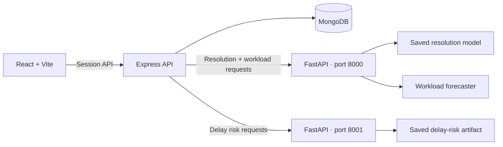

# OpsPilot AI

**A role-based help-desk operations workspace that carries customer and IT tickets through AI-assisted triage, resolution estimates, and workload planning.**

OpsPilot connects a React workspace, an Express API, MongoDB, and two isolated FastAPI model runtimes. Customers and IT Team members submit scoped tickets; admins review and assign them, inspect delay-risk and resolution signals, and refresh a linked ticket's workload outlook from recent history.

## What is implemented

- Customer, IT Team, and Admin roles with server-enforced ticket ownership, assignment scopes, replies, status/priority controls, attachments, recommendation decisions, and audit entries.
- Ticket creation-time scoring using the saved delay-risk classifier and resolution-time regressor; admins can run a single ordered risk → resolution → workload pipeline for an existing ticket.
- Live 7- or 14-day workload forecasts from refreshed ticket-level or daily aggregate CSV data; the resulting outlook is saved back to the linked ticket.
- Admin user/role management, dashboards, analytics, prediction history, and capacity scenarios comparing entered baseline/proposed tickets-per-day against saved forecasts.

## Architecture



Ticket and integrated-pipeline requests go through Express; completed model outputs and ticket changes are stored in MongoDB. The standalone workload page also uses an authenticated Express proxy for its health check and forecast request. See [`docs/ARCHITECTURE.md`](docs/ARCHITECTURE.md) and [`docs/API.md`](docs/API.md).

## Quick start — Windows PowerShell

Prerequisites: Node.js 20 or newer, Python 3.12, and MongoDB. Docker Desktop is an easy way to run the local database; an existing MongoDB instance also works.

```powershell
# From the repository root
py -3.12 -m venv .venv312
.\.venv312\Scripts\Activate.ps1
python -m pip install --upgrade pip
python -m pip install -r ml\requirements.txt
npm run install:all
py -3.12 -m venv .venv-delayrisk
.\.venv-delayrisk\Scripts\python.exe -m pip install --upgrade pip
.\.venv-delayrisk\Scripts\python.exe -m pip install -r ml\requirements-delay-risk.txt
Copy-Item server\.env.example server\.env
Copy-Item client\.env.example client\.env
```

Set a unique `SESSION_SECRET` in `server/.env` before signing in. Keep `.env` files local; never commit credentials. Start MongoDB and then run from the repository root:

```powershell
npm run db:up
npm run dev
```

`npm run db:up` starts a local MongoDB container and waits for its health check. The database port is bound to localhost only. `npm run db:down` stops it without deleting saved data.

Provision the single Admin owner with the protected setup command documented in [`docs/database-architecture.md`](docs/database-architecture.md); public signup cannot create an Admin. The services use ports 8000 (resolution/workload), 8001 (delay risk), 5000 (Express), and 5173 (Vite). Open `http://localhost:5173`.

For separate terminals or troubleshooting, use the exact instructions in [`docs/LOCAL_SETUP.md`](docs/LOCAL_SETUP.md).

## Model evidence and limitations

- **Resolution time:** the included notebook reports chronological held-out test MAE 692.21 hours, RMSE 1,215.48 hours, and R² -0.0982 on 9,877 rows. MAE is 678.95 hours lower than the saved median-baseline MAE (1,371.16 hours), while negative R² indicates worse squared-error performance than a mean predictor. Treat the estimate as experimental planning context, not an SLA promise.
- **Workload:** the notebook/report contains offline walk-forward evaluation on historical data. The live upload endpoint refits an XGBoost top-configuration ensemble on the submitted history. Its returned ranges are variability-based planning estimates, not calibrated 90% intervals; arbitrary uploaded data has no established accuracy claim.
- **Capacity scenarios:** Admins enter baseline/proposed daily ticket capacity. The scenario compares daily forecast demand with those values and tracks uncovered tickets; it is arithmetic planning support, not an inferred staffing recommendation or causal savings estimate.
- **Delay risk:** the saved classifier runs in an isolated scikit-learn 1.6.1 service. Its historical target is resolution taking over 720 hours; its review threshold emphasizes recall. Complaint text is context, not a model feature, and the score is not an SLA guarantee.
- The ZIP includes no raw dataset, and the separate newer forecasting notebook mentioned in the project brief is not included. The repository's original workload notebook is present.

See [`docs/ML_MODEL_INVENTORY.md`](docs/ML_MODEL_INVENTORY.md) for the input/output contracts and [`docs/PROJECT_AUDIT.md`](docs/PROJECT_AUDIT.md) for verified gaps.

## Checks

```powershell
npm --prefix server run build
npm --prefix server test
npm --prefix client run build
.\.venv312\Scripts\python.exe -m unittest ml.test_resolution_api ml.test_workload_forecast
```

These commands check compilation and focused tests. End-to-end ticket and prediction workflows require MongoDB and both ML services; workload forecasts require refreshed history spanning at least 120 days. See [`docs/TEST_REPORT.md`](docs/TEST_REPORT.md) for verified results and remaining demo checks.
