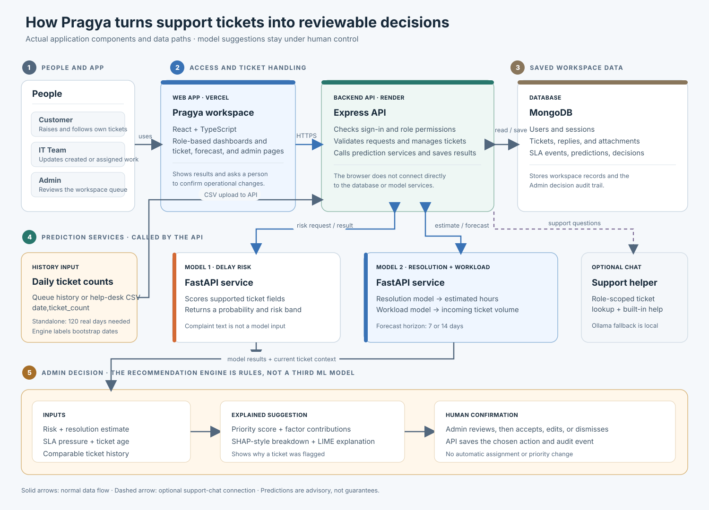

# Pragya — Turn ticket history into clearer support decisions

<p align="center">
  
</p>

<h3 align="center">One workspace for tickets, delay risk, resolution estimates, and workload planning.</h3>

Pragya is a help-desk operations app. Customers and IT staff use it to manage support tickets. Admins use it to review the queue, understand possible delays, estimate resolution time, and plan incoming workload. The app gives people evidence to make decisions; it does not silently assign staff or change a ticket’s priority for them.

> **New here?** Start with [What the app does](#what-the-app-does), then try the [live app](#try-the-live-app), run it with [Docker Compose](#run-with-docker-compose), or follow the [manual local setup](#run-it-on-your-computer).

## Try the live app

These are the deployment addresses supplied for this project:

| Part | Link | What it is |
| --- | --- | --- |
| Web app | [Open Pragya](https://ops-pilot-ai-flax.vercel.app/) | The website you open and use in your browser. |
| Backend API | [API service](https://opspilot-aigarg-api.onrender.com/) | The server that handles sign-in, tickets, permissions, and data. |
| API readiness check | [Check API readiness](https://opspilot-aigarg-api.onrender.com/api/v1/health/ready) | Reports whether the API and required connected services are ready. |
| Model 1: delay risk | [Delay-risk model service](https://opspilot-aigarg-delayrisk.onrender.com/) | Estimates the chance that a ticket will take a long time to resolve. |
| Model 2: resolution and workload | [Resolution and workload model service](https://opspilot-aigarg-resolution.onrender.com/) | Estimates resolution time and creates workload forecasts. |

The model addresses are service endpoints, not separate user-facing apps. Use Pragya through the web app. A free hosting service may take a little while to wake up after being idle. The readiness link is the useful check for the backend; a sleeping or unreachable model can make prediction features temporarily unavailable.

### Who can use it?

- **Customer:** create a support ticket, follow its progress, reply, and ask the support assistant for help with common workflows.
- **IT Team:** work on tickets they created or were assigned, post updates, change allowed work statuses, and use the support assistant.
- **Admin:** review the workspace ticket queue, inspect recommendations and prediction evidence, manage users and SLA policies, and view analytics and workload forecasts.

Public sign-up does not create an Admin account. Admin access is provisioned by the workspace owner. Do not use real customer or confidential information in a demo unless the deployment has been approved for it.

## What the app does

1. A Customer or IT Team member creates a ticket.
2. Pragya saves the ticket and its activity. Where model services are available, it also requests delay-risk and resolution-time estimates.
3. An Admin reviews the ticket and its evidence in the queue or Recommendation Engine.
4. The Admin decides whether to accept, change, or dismiss a suggestion. Any assignment or priority change is a separate, human-confirmed action.
5. Workload Forecasting uses ticket counts over time to estimate how many new tickets may arrive. It helps with planning; it does not decide staffing levels.

## How a ticket becomes an actionable decision

Follow the numbered path: people use the role-based website; the API checks access and handles the request; MongoDB stores operational records; the two model services return separate predictions; then the Admin reviews an explained suggestion and confirms any action. Workload history and the optional support assistant are shown as separate paths so their roles are clear.

<p align="center">
  
</p>

Solid arrows show normal data flow; dashed arrows mark the optional support-chat path. Model services return estimates and do not edit tickets. The Recommendation Engine is rules-based logic in the backend, not a third trained ML model.
### The three decision steps

The Admin **Recommendation Engine** runs a sequence; it is not a third trained ML model:

1. **Delay risk (Model 1):** estimates whether a ticket resembles historical cases that took a long time to resolve. The complaint text is not used as a model feature.
2. **Resolution time (Model 2):** estimates a duration in hours from supported ticket fields. Treat it as an experimental estimate, not a promise.
3. **Workload outlook (Model 2 service):** estimates incoming ticket volume from daily ticket counts. It is a planning aid, not a staffing decision.

The priority recommendation is a transparent rules-based calculation, not another trained model. Its current factors are delay-risk probability, similar historical ticket outcomes, SLA clock pressure, estimated resolution time compared with the SLA time remaining, and ticket age. The Admin can see the factor contributions (SHAP-style breakdown) and a local LIME-style explanation to understand why a ticket received its score. Missing signals are left out and the remaining weights are adjusted. This helps explain the calculation; it does not prove the recommendation is correct. The model uses the ticket's current priority as an input, and does not feed the suggested priority back into the same prediction. The delay-risk score is not the same thing as an official SLA breach; SLA clocks are calculated separately from configured policy and ticket events.

## Main areas of the app

| Area | What you can do there |
| --- | --- |
| **Overview** | See a role-appropriate summary of current work and items that need attention. |
| **Ticket Queue** | Admins review workspace tickets and can export the queue history CSV used by the Recommendation Engine. |
| **Pipeline** | Run the ordered risk, resolution, and workload analysis for a ticket. |
| **Recommendation Engine** | Select a ticket, review the model and operational evidence, then decide which suggestion to act on. |
| **Model Center** | Check registered model service status and available model information. A green/available service does not prove that its predictions are accurate. |
| **Prediction History** | Review saved prediction and decision records within the signed-in role’s access. |
| **Analytics** | Explore operational and SLA summaries. These are reports, not additional ML models. |
| **Workload Forecasting** | Forecast incoming ticket counts from workspace history or an imported CSV. At least 120 complete calendar days are required. |
| **SLA Management** | Admins review and manage service-level policies and ticket clocks. |
| **Users & Roles** | Admins manage workspace access and IT Team accounts. |
| **Support assistant** | Customer and IT Team users can ask about help workflows and their authorized tickets. It cannot edit tickets or change priority, assignments, or SLAs. |

The visible navigation depends on the signed-in role. The API enforces permissions too, so hiding a page in the website is not the only access check.

The support assistant answers recognized help and ticket-status questions from built-in guidance and role-authorized ticket details. An optional local Ollama model can respond to unmatched questions. In the current implementation, retrieved ticket/help details are not sent as context to Ollama, so treat that fallback as general assistance rather than a verified answer about a specific ticket.

## Run with Docker Compose

Docker Compose builds and runs the website, API, model services, and MongoDB. You do not need to install Node.js, Python, or MongoDB on the host computer.

### Requirements

- Windows with Docker Desktop installed and running.
- The repository cloned to the computer.

### First run

Open PowerShell in the repository folder. Create a private `.env` file with fresh random secrets, then start the stack:

```powershell
if (-not (Test-Path .env)) {
  Copy-Item .env.docker.example .env
  $sessionSecret = [Convert]::ToBase64String([Security.Cryptography.RandomNumberGenerator]::GetBytes(48))
  $modelApiToken = [Convert]::ToBase64String([Security.Cryptography.RandomNumberGenerator]::GetBytes(48))
  $envLines = Get-Content .env
  $envLines = $envLines -replace '^SESSION_SECRET=.*$', "SESSION_SECRET=$sessionSecret"
  $envLines = $envLines -replace '^MODEL_API_TOKEN=.*$', "MODEL_API_TOKEN=$modelApiToken"
  $envLines | Set-Content -Encoding ascii .env
}

docker compose up -d --build --wait
```

Open **http://localhost:8080**. The first build downloads images and dependencies, so it may take several minutes. Create an account from this local app; accounts from another environment will not work unless both environments use the same database.

If PowerShell says `docker` is not recognized after Docker Desktop is installed, reopen PowerShell. For a per-user Docker Desktop install, add its CLI folder to the current session's `PATH`:

```powershell
$dockerBin = Join-Path $env:LOCALAPPDATA 'Programs\DockerDesktop\resources\bin'
if (Test-Path "$dockerBin\docker.exe") { $env:Path = "$dockerBin;$env:Path" }
docker compose version
```

### Useful commands

```powershell
docker compose ps             # Check service status
docker compose logs -f        # Follow logs from all services
docker compose logs -f api    # Follow API logs only
docker compose down           # Stop the stack; keep saved database data
docker compose up -d --wait   # Start it again without rebuilding
```

Compose stores database data in the persistent `opspilot_mongo_data` volume on that PC. To share the same accounts and tickets across devices, set `MONGODB_URI` in each device's private `.env` to the same MongoDB connection string, then run `docker compose up -d --build --wait`. Leave it blank to use the local MongoDB container. Never commit `.env` or share its connection string. Avoid `docker compose down --volumes` unless you intend to delete the local database.

## Run it on your computer

### What you need

- Windows with PowerShell (the commands below use PowerShell).
- Node.js 20 or newer and npm.
- Python 3.12.
- MongoDB. You can use an existing local/remote MongoDB or start the included MongoDB container with Docker Desktop.

The model services need their Python packages and saved artifacts. The delay-risk model uses its own Python environment to keep its scikit-learn version separate from the resolution/workload service.

### 1. Install dependencies

Open PowerShell in the project folder and run:

```powershell
py -3.12 -m venv .venv312
.\.venv312\Scripts\Activate.ps1
python -m pip install --upgrade pip
python -m pip install -r ml\requirements.txt

py -3.12 -m venv .venv-delayrisk
.\.venv-delayrisk\Scripts\python.exe -m pip install --upgrade pip
.\.venv-delayrisk\Scripts\python.exe -m pip install -r ml\requirements-delay-risk.txt

npm run install:all
Copy-Item server\.env.example server\.env
Copy-Item client\.env.example client\.env
```

If PowerShell blocks activating the first Python environment, you can still run the explicit `\.venv312\Scripts\python.exe` path used by the project scripts. Keep `.env` files on your computer; they may contain private settings. Set a fresh random `SESSION_SECRET` in `server/.env` before signing in locally.

### 2. Start MongoDB

**Option A — use Docker Desktop for only the database:**

```powershell
npm run db:up
```

This starts MongoDB only. It does not run the Pragya website or models. To stop the database later without deleting its saved volume, run `npm run db:down`.

**Option B — use MongoDB you already have:**

Skip `npm run db:up` and set `MONGODB_URI` in `server/.env` to that database address.

### 3. Start the app

From the repository root, run:

```powershell
npm run dev
```

This starts four local services together: the resolution/workload model, delay-risk model, API, and website. Keep the terminal open while using the app. Open **http://localhost:5173** in your browser.

So, `npm run dev` is the command to start the application after setup; it does not install packages and it does not start MongoDB. If you only start the Vite website with `npm --prefix client run dev`, pages that need the API or database will not work fully.

### Sign in as Admin locally

Public sign-up cannot make an Admin. The protected Admin provisioning steps are in [`docs/database-architecture.md`](docs/database-architecture.md). Follow that guide only for a local workspace you own, and remove temporary provisioning values from `server/.env` after setup.

For the full environment-variable list, individual-terminal startup, health checks, and troubleshooting, see [`docs/LOCAL_SETUP.md`](docs/LOCAL_SETUP.md).

## Importing workload history

The forecast needs **120 complete calendar days** of counts. You can use actual ticket history already in the workspace when enough days exist, or import daily counts from your help desk:

1. Open **Admin → Workload Forecasting** or the history section in the Recommendation Engine.
2. Download the dated CSV template (or the queue-history export when using the Recommendation Engine).
3. Fill the template with real daily totals. Its aggregate format is `date,ticket_count`, with one date per row. A day with no tickets should have count `0`.
4. Choose the completed CSV and select the forecast horizon (7 or 14 days).
5. Run the forecast and review its history range, totals, and planning estimates.

Do not put complaint descriptions, passwords, or customer secrets in the aggregate history file. Workload forecasts incoming volume; the displayed planning ranges are variability-based estimates, not calibrated confidence intervals. The Recommendation Engine’s rolling history can mark bootstrap values before real queue history is available; do not mistake those simulated values for company history.

## What the predictions can and cannot tell you

- **Delay risk** is a historical pattern score, not certainty about a particular ticket and not an official SLA-breach prediction.
- **Resolution time** is an experimental point estimate. It can be wrong and should not be communicated as a promised completion time.
- **Workload** estimates incoming ticket volume. It does not measure staff capacity, recommend a headcount, or automatically schedule people.
- **Recommendations** support an Admin’s review. Human confirmation is required for assignment and priority changes.
- **Model service health** only says a service responded; it does not establish model quality or guarantee a correct result.
- **Complaint text** is kept as ticket context for people and support workflows. It is not a feature for the trained risk/resolution models or the workload count forecast.

## If something does not work

| What you see | What to check |
| --- | --- |
| Sign-in or saved pages fail | Is MongoDB running? Check `MONGODB_URI` in `server/.env` and the API terminal. |
| A model says unavailable | Confirm both Python environments were installed, model artifacts/configuration exist, and ports 8000 and 8001 are free. On the live deployment, check the API readiness link and allow a sleeping host time to wake. |
| Forecast says history is too short | Supply at least 120 complete calendar days of real counts and check that every CSV row has a valid date and non-negative whole-number count. |
| The page loads but buttons/data fail | `npm run dev` should be running from the repository root; check the API terminal on port 5000. |
| A port is already in use | Stop the other process using 5173, 5000, 8000, or 8001, then restart the affected service. |
| Support assistant has no generated response | It can provide retrieval-based answers without Ollama. The optional local-model fallback needs Ollama running on the same computer as the API. |

For local service readiness checks, see [`docs/LOCAL_SETUP.md`](docs/LOCAL_SETUP.md#verify-service-state). For the endpoint contracts, see [`docs/API.md`](docs/API.md).

## Project map

```text
Project root/
├── client/                 React + TypeScript website (Vite)
│   ├── public/assets/      Logo and public assets
│   └── src/                Pages, shared components, API client, styles
├── server/                 Express API, access rules, ticket services, tests
├── ml/                     FastAPI model services, artifacts, notebooks
├── docs/                   Setup, architecture, API, and model notes
├── compose.yaml            Full local stack: website, API, model services, and MongoDB
├── render.yaml             Render API and model-service configuration
└── package.json            Root scripts, including npm run dev
```

## More documentation

- [Local setup and troubleshooting](docs/LOCAL_SETUP.md)
- [Full system and role data-flow diagrams](docs/OPS_PILOT_DATA_FLOW.md)
- [Architecture notes](docs/ARCHITECTURE.md)
- [API reference](docs/API.md)
- [Model inventory and limitations](docs/ML_MODEL_INVENTORY.md)
- [Vercel + Render deployment notes](docs/DEPLOY_VERCEL_RENDER.md)

## Development checks

Run these from the repository root when you change code:

```powershell
npm --prefix server run build
npm --prefix server test
npm --prefix client run build
```

Python model tests and any additional integration checks are documented in [`docs/TEST_REPORT.md`](docs/TEST_REPORT.md). A full end-to-end workflow also needs MongoDB and both model services running.
