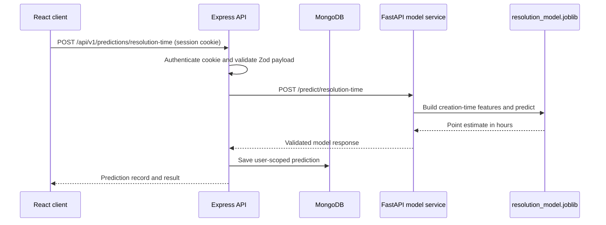

# OpsPilot AI architecture

## Runtime flow

The standalone workload upload uses the authenticated Express API: the browser posts CSV-derived daily records to `POST /api/v1/predictions/workload`, which validates the request and forwards it to FastAPI `/forecast/workload`. Forecast results are returned to the page and are not persisted in MongoDB. The page checks `GET /api/v1/predictions/workload/health` before enabling the forecast action. Both the Triage and standalone pages use the same client history reducer, so ticket-level uploads retain only `Ticket`, `Service`, and `HD Service` issue types before aggregation.

## Boundaries

### React client

The client owns navigation, accessible forms, theme state, loading/error/empty states, charts, and presentation. Authenticated API calls use `credentials: include` through one centralized typed API client. The workload CSV page calls the Express proxy rather than the FastAPI service directly; the client does not connect to MongoDB or import Python code.

### Express API

The API owns authentication, authorization, request validation, session lifecycle, user-scoped queries, model registry composition, ML timeouts, response validation, and persistence. It starts even when MongoDB is unavailable so liveness can be diagnosed; data routes return a safe 503 until the database is ready.

### FastAPI model service

The model service loads the existing joblib pipeline during import/startup. It exposes health, verified schema metadata, and inference. It never trains, writes, or replaces the artifact. Unsupported categorical values return 422 rather than relying on an unknown-category fallback.

### MongoDB

Mongoose stores `User`, `Session`, and `Prediction` documents. Prediction history is indexed by `userId`, `modelId`, and `createdAt`, and every detail/delete query includes the authenticated user ID.

## Authentication

Signup and login create a random opaque session token. The API stores only an HMAC hash of that token in MongoDB and sends the raw token in an HTTP-only, same-site cookie. Logout deletes the matching session. The browser never receives a bearer token and does not use localStorage for authentication.

## Model registry

`server/src/services/modelRegistry.ts` is the shared registry. The resolution model is `available` only when the FastAPI health endpoint responds with an available status. Future models use `coming_soon` until their real services are registered. A connected service that fails health checks is `unavailable`, which is distinct from an unimplemented model.

## Persistence contract

Successful resolution predictions store:

- authenticated user reference;
- model ID and known artifact timestamp/version;
- point-estimate type;
- the four validated prediction-time inputs;
- returned duration and unit;
- creation timestamp and status.

Failed model requests may store a minimal failed record with an error code, but the API never stores a fabricated output.

## Extension points

New models should reuse:

1. `requireAuth` and the existing session lifecycle.
2. `PredictionModel` with a validated model-specific input/output subdocument or a dedicated schema when the shape is materially different.
3. `modelRegistry.ts` for status and health.
4. The shared app shell, history filters, theme, and error states.
5. A separate Python inference adapter with its own verified metadata endpoint.

See [`ML_INTEGRATION_GUIDE.md`](ML_INTEGRATION_GUIDE.md) for the teammate contract.
